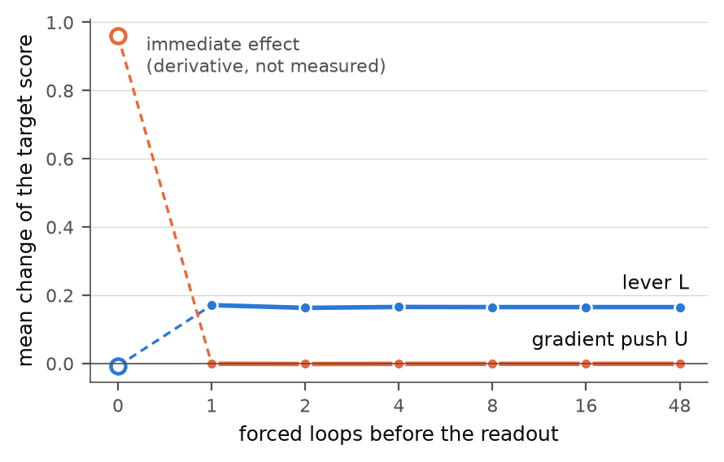
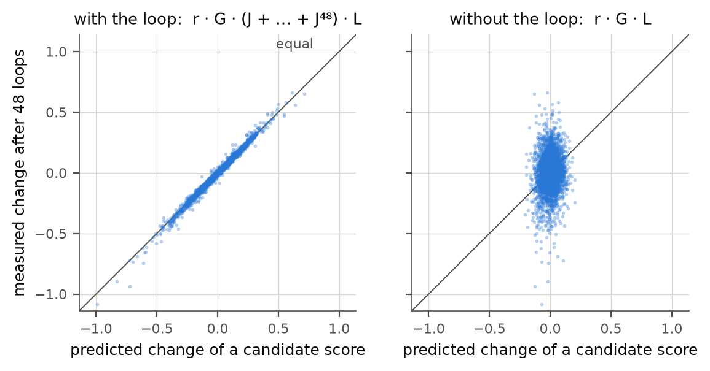
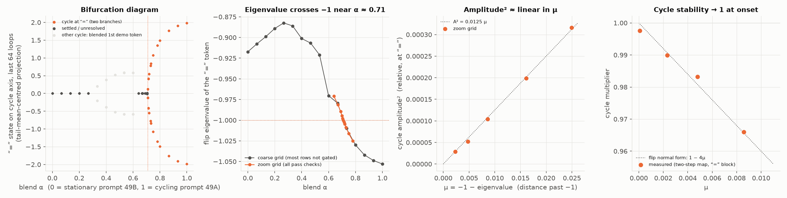
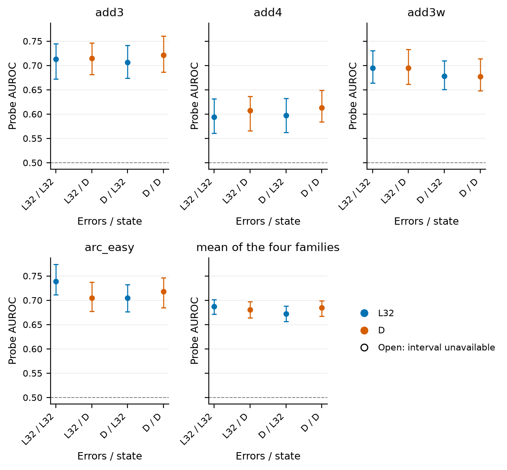

<!--
THE AUTHOR'S PAGE. Everything on this page is written by the author.
Delete this comment when the page is done.

A shape that works:
  1. The question, in two or three sentences.
  2. One or two results you can explain without notes, with one figure.
  3. What you are unsure of.
  4. How it was made: what you did, and what the AI agents did.
  5. What comes next.

Figures you can use (paste a line to show one):
        the obvious push dies after one loop, the lever does not
          predicted against measured change, with and without the loop
     the period-two cycle appearing
     error-probe scores, looped against ordinary
-->

# Steering looped transformers

**Preliminary.** This repository currently holds an AI-drafted write-up of the project:
[RESEARCH_NOTE.md](RESEARCH_NOTE.md). It was drafted by AI agents under the author's direction and has not been
peer reviewed. The author's own write-up will follow and will replace this page.

## What was found

*This summary was drafted by AI agents, like the note it comes from. Figures, methods and limits are in
[RESEARCH_NOTE.md](RESEARCH_NOTE.md).*

1. **Steering has to go through the loop.** A push along the direction the readout is most sensitive to has almost
   no effect once the loop has run. A push built from the loop's own linear response does have an effect, and its
   size is predicted problem by problem (correlation 0.997 on one model and 0.978 on another). In a follow-up,
   forecasts saved before the intervention named the exact next token on 21 of 24 near-tie prompts, against 11 of 24
   for assuming no change.
2. **Some prompts never settle.** On about 13% of fresh addition prompts, Huginn's state ends in a cycle of period
   two. In all 26 such prompts found in a census, the earliest cycling token has an eigenvalue of the loop just past
   −1, and damping that token by the amount the eigenvalue predicts stops its oscillation in 24 of them. A targeted
   search found sums whose written answer depends on whether the number of loops is odd or even.
3. **No monitoring advantage was resolved.** In a registered comparison on one matched pair (a looped model, and an
   ordinary model trained from the same starting weights on the same data), a linear probe predicted each model's own
   errors about equally well: an area under the ROC curve of 0.687 against 0.685.
4. **Several attractive ideas did not hold up**, and are reported as such in [Section 4](RESEARCH_NOTE.md#4-what-did-not-hold-up).

These are local measurements on small models and arithmetic-style tasks. Please read [Limits](RESEARCH_NOTE.md#limits) before
citing a number.

*Recurrent-Llama-3.2. A push along the readout gradient has a large immediate effect by the derivative (hollow
point, predicted and not measured) and none after one loop. The push built from the loop's response has almost no
immediate effect and a lasting one.*

## Where things are

- [RESEARCH_NOTE.md](RESEARCH_NOTE.md): the full research note, drafted by AI agents
- [docs/steering_results.pdf](docs/steering_results.pdf): steering through the loop
- [docs/monitor_results.pdf](docs/monitor_results.pdf): the error-monitor experiment
- [huginn_addition/WRITEUP.md](huginn_addition/WRITEUP.md): the first model, including the period-two cycles
