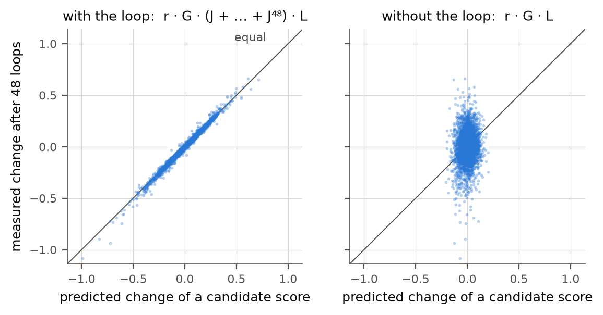
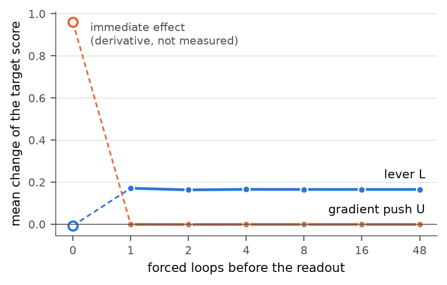
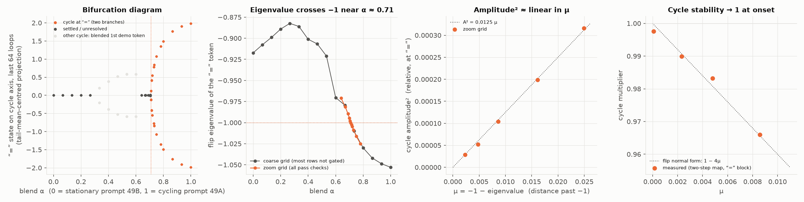
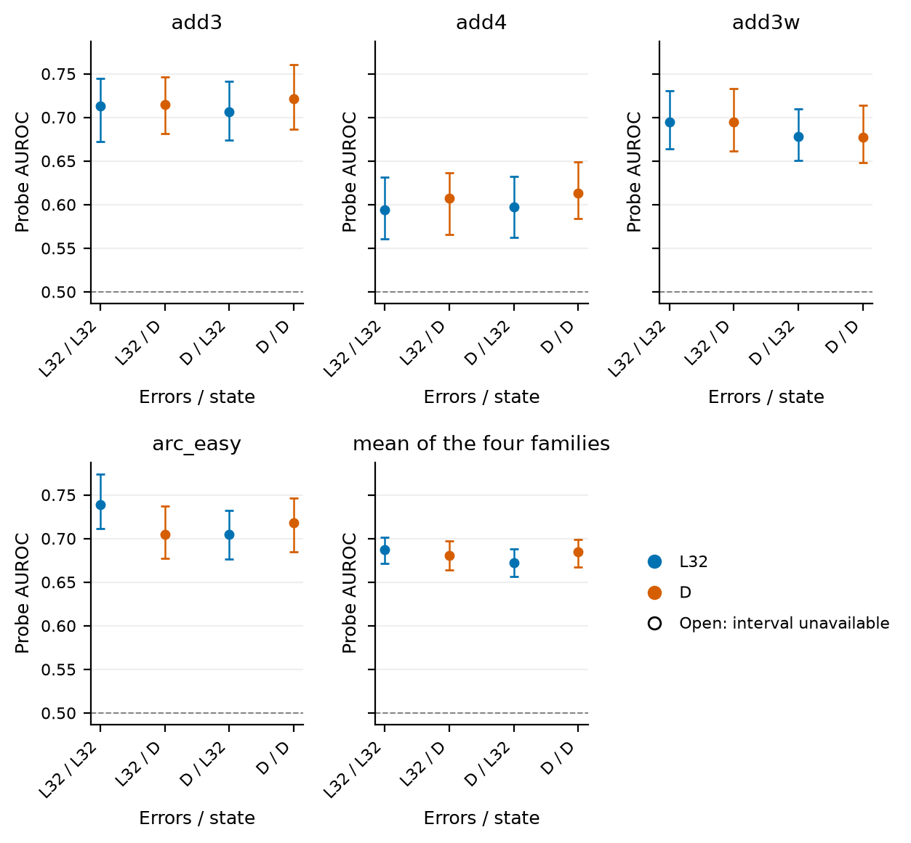

# Looped language models as dynamical systems

**What repeating a block does to reading and steering a model's hidden state**

*Preview research note, November 2026. Work in progress and not peer reviewed.*

*This is a preliminary write-up. It and the linked write-ups were drafted by AI agents under the author's
direction; the author's own write-up will follow. See [How this was done](#how-this-was-done).*

A *looped* (recurrent-depth) language model applies the same block of layers many times to a hidden state before it
writes a token. Whatever it works out in those repeated passes is never written down, so it cannot be caught by
reading the model's chain of thought ([Korbak et al., 2025](https://arxiv.org/abs/2507.11473)). This project asks
whether such a model is harder or easier to oversee than an ordinary one, in two concrete senses:

- **Monitoring.** Can a simple reader of the hidden state tell when the model's answer will be wrong?
- **Steering.** Can we predict which vector, added to the hidden state, moves the answer, and by how much?

The approach is to treat the loop as a dynamical system, $x_{t+1} = F(x_t)$, and measure its local behaviour: where
the state settles, the derivative $J$ of one pass at that point, and how well $J$ predicts what an intervention
does. Everything uses public checkpoints of three looped models (Huginn-0125, Recurrent-Llama-3.2 and Ouro-1.4B,
between 1 and 3.5 billion parameters) and ran on single A100 GPUs.

## Findings in brief

1. **Steering has to go through the loop.** A push along the direction the readout is most sensitive to has almost
   no effect once the loop has run. A push built from the loop's own linear response does have an effect, and its
   size is predicted problem by problem (correlation 0.997 on one model and 0.978 on another). In a follow-up,
   forecasts saved before the intervention named the exact next token on 21 of 24 near-tie prompts, against 11 of 24
   for assuming no change.
2. **Some prompts never settle.** On about 13% of fresh addition prompts, Huginn's state ends in a cycle of period
   two. In all 26 such prompts found in a census, the earliest cycling token has an eigenvalue of the loop just past
   −1, and damping that token by the amount the eigenvalue predicts stops its oscillation in 24 of them. A targeted
   search found sums whose written answer depends on whether the number of loops is odd or even.
3. **No monitoring advantage was resolved.** In a registered comparison on one matched pair (a looped model, and an
   ordinary model trained from the same starting weights on the same data), a linear probe predicted each model's own
   errors about equally well: an area under the ROC curve of 0.687 against 0.685.
4. **Several attractive ideas did not hold up**, and are reported as such in [Section 4](#4-what-did-not-hold-up).

These are local measurements on small models and arithmetic-style tasks. Please read [Limits](#limits) before
citing a number.

## 1. Steering has to go through the loop

**Setup.** Let the state at the answer position settle. Then add a small fixed vector $P$ to it before every further
pass, and read how the scores of the candidate answers have changed after $T$ passes. To first order the change is

$$\Delta R \;\approx\; G\,(J + J^2 + \dots + J^T)\,P ,$$

where $J$ is the derivative of one pass at the settled state and $G$ is the derivative of the readout. The formula
is standard calculus: it is how models defined by a fixed point are differentiated
([Bai et al., 2019](https://arxiv.org/abs/1909.01377)). The measurements are how far it reaches in trained looped
language models, and what it implies for choosing $P$.

**Two pushes of the same length.** The *readout gradient* is the direction that would raise the target score most
if the state were read at once. The *lever* is the direction that raises it most after the loop has run, which is
the same gradient carried back through the $T$ passes. On the second model the two are nearly orthogonal (cosine
−0.005).

| | Huginn-0125 | Recurrent-Llama-3.2 (32 loops) |
|---|---|---|
| Task (ten candidate answers in both) | units digit of a two-digit sum | two-digit sums equal to 70, …, 79 |
| Held-out problems | 20 | 40 |
| Push length | 3 | 3% of the state's length |
| Lever: mean change of the target score | +1.78 | +0.165 [0.154, 0.177] |
| Readout gradient: mean change of the target score | −0.05 | −0.001 [−0.002, 0.000] |
| Prediction with the loop, against measurement: correlation, slope, relative error | 0.978, 0.95, 22.1% | 0.997, 1.01, 7.7% |
| Prediction without the loop ($G P$ alone): correlation | −0.587 | 0.114 |

Scores are centred logits; correlations are medians over problems of the correlation across the ten-by-ten table of
pushes and candidates; brackets are 95% intervals. The two columns are separate experiments that differ in task,
dose and numerical precision, so they are a replication of the pattern and not a controlled comparison of models.

<p align="center">

</p>

*Recurrent-Llama-3.2, main dose. Each point is one entry of a measured response table (40 problems, ten lever
pushes, ten candidate scores) against its prediction. Left: using the loop's linear response. Right: using the
readout's derivative alone.*

<p align="center">

</p>

*Same experiment. The gradient push has a large immediate effect by the derivative (hollow point, predicted and not
measured), and none after one loop. The lever has almost no immediate effect, and after one loop its mean effect is
already close to the final value (the full table of responses keeps changing for a few more loops).*

Further results on the second model:

- **Proportional to the dose** over a ninefold range: +0.055, +0.165 and +0.480 at 1%, 3% and 9% of the state's
  length. The prediction error grows with the dose (2.6%, 7.7%, 21.7%), as a first-order statement should.
- **Repetition matters for a few loops.** At the smallest dose, a prediction from a single pass misses the final
  response by 25.3%. With four passes the error is 3.3%, and from eight passes on it equals that of the full sum
  (2.6%).

**A forecast made before the intervention (17 November).** The loop's linear response was used to forecast which
token would win after a sustained push, across the whole vocabulary. The forecasts were written to a file before
the stage that measures pushed outputs could run: the script enforces that order, and the hash of the forecast file
is recorded in the report. From 768 fresh prompts, a fixed rule selected 24 near ties (top two candidates within 0.5
logits) and 24 clear leads (at least 2 logits apart). The push was the frozen lever for each prompt's runner-up. At
the largest dose (9% of the state's length), on the near ties:

| Forecast | Exact winner correct | Mean error of the forecast margin change (logits) |
|---|---|---|
| Loop's linear response, 48 terms | 21 of 24 | 0.086 |
| One term (a single pass) | 20 of 24 | 0.197 |
| No change | 11 of 24 | 0.514 |

Twelve of the 24 near ties switched to the pushed runner-up and one to a third token. On the 24 clear leads no
winner changed at any dose, and every forecast said so. The difference between the two loop-aware forecasts is not
resolved by this sample, and 22 of the 24 near ties come from one task family. Details: the section "Predicting the
winning token on near ties" of [`docs/steering_results.pdf`](docs/steering_results.pdf), and
[`results/llever_winner-20261117/report.md`](results/llever_winner-20261117/report.md).

**What this does not show.**

- *Control of answers in general.* On Recurrent-Llama-3.2 the pushes move scores by a small fraction of a typical
  lead. In the main replication (correct answers leading by a median of 4.84 logits), no push at any tested dose made
  the pushed candidate the answer, in 360 pairs of a problem and a candidate; at the largest dose, five pushes changed
  the answer to something else. The pushed candidate won only in the sample selected for near ties.
- *A change in what the model "believes".* On a true/false task in Huginn the same construction moved the log-odds
  by 8.1, against 0.93 for the readout gradient and 0.25 for a probe's direction, at a larger dose. But when a
  probe chose the sign of the push, the steered answers reproduced the probe's verdict exactly and added no
  accuracy.
- *Anything new in method.* Pushing along a direction pulled back through a Jacobian in a looped language model,
  and later loops undoing an early intervention, were reported by
  [Wang and Reid (2026)](https://arxiv.org/abs/2609.01924). A targeted literature search did not find the three
  measurements above: the problem-by-problem prediction of a sustained push from $J + \dots + J^T$, the lever being
  nearly orthogonal to the readout gradient, and the gradient push losing its effect.

Full account: [`docs/steering_results.pdf`](docs/steering_results.pdf) and, for the first model,
[`huginn_addition/WRITEUP.md`](huginn_addition/WRITEUP.md).

## 2. Some prompts never settle

In most prompts the state at the answer position approaches a fixed point. In Huginn-0125 a minority do something
else.

- **How often.** In a census of 200 fresh addition prompts, about 13% (95% interval 8% to 18%) contain a position
  that settles into a cycle of period two: the state alternates between two values for as long as the loop runs.
- **Where it comes from.** In all 26 cycling prompts of the census, the earliest cycling token has a real
  eigenvalue of its own block of the Jacobian just past −1 (between −1.007 and −1.226, median −1.07), measured at
  the unstable fixed point between the two cycle states. Later positions inherit the cycle: in six case studies,
  freezing everything before the answer position stopped the cycle there.
- **Watching it appear.** Sliding the input continuously from a prompt that settles to one that cycles, the tracked
  eigenvalue crosses −1, the squared amplitude of the cycle grows linearly with the distance past −1, and the
  stability of the cycle follows the leading-order prediction for a period-doubling (flip) bifurcation. This
  replicated on a second pair of prompts. The agreed wording is "consistent with" such a bifurcation, not
  "established".
- **A prediction that was tested.** Damping the update at the source token, $x \leftarrow (1-a)\,x + a\,F(x)$,
  moves its eigenvalue $\lambda$ to $1 - a + a\lambda$, so the eigenvalue says how much damping should stop the
  cycle. Damping only that token stopped its oscillation in 24 of 26 prompts. An undamped control kept oscillating
  in 26 of 26, and damping below the predicted threshold kept it oscillating in 25 of 25. The whole sequence became
  stationary in only 15 of 26, so other positions often keep moving.

<p align="center">

</p>

*Huginn-0125. Blending the input from a prompt that settles (0) to one that cycles (1): the two branches of the
cycle, the eigenvalue crossing −1, the squared amplitude against the distance past −1, and the stability of the
cycle against the flip normal form.*

**Does it change what the model writes?** Usually not. For all 26 cycling census prompts, greedy answers were
identical at 509, 510, 511 and 512 loops. But a search aimed at near-tied answer digits found four real sums where
the most probable answer digit alternates with the parity of the loop count. Continuing from `816 + 254 =`, the
model writes ` 1070` (correct) with 511 loops per token and ` 1060` with 512. This is an existence result from a
search that selected three times over (oscillating contexts, then near ties, then hits): four of 358 selected
answer positions, with a fixed starting state. It says nothing about accuracy in general.

Full account: [`huginn_addition/WRITEUP.md`](huginn_addition/WRITEUP.md), Section 2.3.

## 3. Does looping make errors easier to detect?

**The comparison.** The only fully verified matched pair that could be downloaded is Recurrent-Llama-3.2 trained
around 32 loops (L32) and an ordinary model (D) trained from the same starting weights on the same data
([McLeish et al.](https://arxiv.org/abs/2511.07384)). The monitor is a linear probe on the state at the last token,
fitted to predict whether that model's own answer is wrong. The design, the analysis script and the decision rule
were fixed before the main data were collected: 6,000 problems in four task families (three kinds of sums and
ARC-Easy), and three random splits of the same problems.

| Reader | L32 | D |
|---|---|---|
| Linear probe on the model's own state | 0.687 | 0.685 |
| Baseline fitted to four numbers from the output probabilities | 0.743 | 0.743 |
| Gain from adding the state to that baseline | +0.003 | +0.006 |

Scores are the area under the ROC curve for predicting an error (0.5 is chance), averaged over the four families,
and each is the median over the three splits. The difference between the two probes is 0.002; the three splits'
95% intervals together run from −0.017 to 0.025. This is "no overall advantage resolved for this pair", not a test
of equivalence.

<p align="center">

</p>

*Probe scores for every combination of whose errors are predicted and whose state is read. The other model's state
predicts a model's errors almost as well as its own.*

- **A lead, found after the fact.** At the second-to-last token, a probe on L32's state predicted L32's errors
  better than a probe on D's state predicted D's, by 0.02 to 0.04 in the three splits. It was noticed in the
  secondary results and has not been tested on new problems.
- **Looking for tasks where the loop acts late.** On these problems L32's answer changes between loops 8 and 32
  only 3.5% of the time. A screen with thresholds fixed in advance covered 18 task families. Two went to a
  confirmation on 300 fresh problems and neither was accepted, so the comparison stopped under its own rule. Of the
  133 late answer changes seen in the screen, 116 went from one wrong answer to another.

This concerns honest mistakes on short problems for one pair of checkpoints. It does not concern a model that
conceals something, and because the two models also differ in how their layers are arranged, it does not isolate
looping as a cause.

Full account: [`docs/monitor_results.pdf`](docs/monitor_results.pdf) and
[`docs/followup_results.md`](docs/followup_results.md).

## 4. What did not hold up

Negative and inconclusive verdicts were kept as registered. The ones that changed how I think about these models:

- **"The loop suppresses what the output reads."** In Huginn a random direction keeps about a quarter of itself
  after one pass and the directions the output reads keep almost nothing. This looked like a general principle. It
  did not carry over: in Recurrent-Llama-3.2 no such deficit was detected, and in Ouro-1.4B the directions the output
  reads keep slightly more than random ones. (The three measurements use different protocols.)
- **"Each loop is one step of a procedure."** In the formats tested, Huginn was 90% correct on one-hop pointer
  queries and 5% to 10% beyond, answering most two-hop queries with the one-hop value, and a longer chain of carries
  did not detectably need more loops. This does not establish a general one-step limit.
- **"The path holds information the endpoint lacks."** No predictive information in the trajectory beyond the final
  state was detected.
- **"A direction that decodes a label is a direction to push."** On the true/false task the probe's direction was
  the weakest of the three pushes tested.
- **"The speed of settling tells you when to stop."** The answer stabilises at a median of loop 7 and the state at
  loop 74; an early-exit rule built on the convergence rate did worse than the model's own.
- **"Depth of training orders the sensitivity."** A pilot across models trained around 4, 8, 16 and 32 loops found
  no overall ordering.

## Concurrent work (20 November 2026)

On 20 November 2026 Thinking Machines released
[Inkling 2 Mini](https://thinkingmachines.ai/news/inkling-2-mini/), an open-weights looped model (24 layers, the
middle 12 run three times per token), together with a research model whose number of passes is chosen at run time.
The release has a section on the question asked here. Its measures are behavioural: how legible and how
controllable the written chain of thought is, and how often a monitor catches sabotage in agentic tasks. It reports
that more passes raise what the model can do without writing its reasoning down, and no clear trend in
monitorability with the number of passes at that scale, and it describes the analysis as preliminary. A
[note from Goodfire](https://www.goodfire.com/research/interpreting-inkling-2-mini/) published the same day studies
how information flows between blocks and passes.

As far as I can tell from the post, the two model cards and that note, none of them reports the internal-state
measurements made here: error probes on the looped state, pushes through the loop and their prediction from the
Jacobian, or fixed points and cycles. The variable-pass model also supplies the two things this project lacked: the
same weights at different numbers of passes and, according to the release, a task on which more passes keep
helping.

## Next steps

1. **Error monitors by number of passes.** On the variable-pass model, fit the registered error probe at 1, 2, 3
   and 5 passes, on a task where passes matter. Using one set of weights removes the main weakness of the matched
   pair above (two separately trained checkpoints), and gives new data for the lead at the second-to-last token.
2. **Levers with few passes.** Compare a push computed through the remaining passes with the plain readout
   gradient, and test whether the loop's linear response still predicts the effect with 3 to 5 passes in place of
   48. That model has no single residual stream, and Goodfire's note reports one coordinate that dominates the norm
   at the end of the looped block, so "the state" and "the dose" have to be redefined first.
3. **Theory.** Find a condition under which a looped model responds more linearly to a push than its ordinary
   partner. The current note proves only that contraction of the loop is not enough
   ([`docs/oversight_results.pdf`](docs/oversight_results.pdf), Section 5).

## Limits

- **Small models and simple tasks.** Models of 1 to 3.5 billion parameters; few-shot arithmetic with single-token
  answers, true/false statements and multiple-choice science questions.
- **Local.** The steering results are first-order statements about small pushes at one token position around a
  settled state, tested along the levers and not along arbitrary directions.
- **Scores, not behaviour.** Shifts of candidate scores on problems the model mostly already answers correctly.
- **One matched pair** for monitoring, and no adversarial setting.
- **Selection.** The Huginn headline results were chosen from about 40 experiments without a correction across the
  whole study; the confirmatory tests were specified per experiment. The parity examples come from a selected
  search.
- **Prior work.** No method here is new. The literature search (about 160 queries on 11 November 2026) was targeted
  and not systematic, so "not found" is not proof of absence.

## Repository guide

| Read this | For |
|---|---|
| [`docs/steering_results.pdf`](docs/steering_results.pdf) | Steering on two models, the forecast on near ties, the self-gain diagnostic on three models, earlier work, and a summary of the monitoring comparison |
| [`huginn_addition/WRITEUP.md`](huginn_addition/WRITEUP.md) | The Huginn study: representations, period-two cycles, levers, mechanism, limits |
| [`docs/monitor_results.pdf`](docs/monitor_results.pdf) | The registered error-monitor experiment |
| [`docs/followup_results.md`](docs/followup_results.md) | The late-change screen and the lever replication |
| [`results/llever_winner-20261117/report.md`](results/llever_winner-20261117/report.md) | The forecast of the winning token |
| [`docs/oversight_results.pdf`](docs/oversight_results.pdf) | A pilot on sensitivity and linearity across loop depths, with a section of theory |
| [`docs/analytic.pdf`](docs/analytic.pdf), [`docs/freeloop.pdf`](docs/freeloop.pdf), [`docs/observability.pdf`](docs/observability.pdf), [`docs/monitor_theory.pdf`](docs/monitor_theory.pdf) | Mathematical notes: why the lever first points against the readout, random-direction steering, what a training loss can see of the loop, and how far a monitor's reading can still move if the loop runs longer |
| [`docs/primer.pdf`](docs/primer.pdf), [`docs/foundations.pdf`](docs/foundations.pdf), [`docs/derivations.pdf`](docs/derivations.pdf) | Background built from definitions, assuming no machine learning |
| [`huginn_addition/README.md`](huginn_addition/README.md) | The experiment log: design, rules fixed in advance, checks, results and caveats for every run |
| [`docs/blog/index.html`](docs/blog/index.html) | A draft interactive explainer of the cycles and the lever, written on 11 to 13 November before the forecast on near ties (download it with its `assets` folder and open it in a browser) |

Layout:

| Path | Contents |
|---|---|
| `huginn_addition/` | All experiment code, despite the name. `*_app.py` are the GPU programs, `analyze_*.py` the analyses (rules fixed in advance are recorded in each docstring), `make_*.py` and `select_*.py` build prompts and pushes, `*_test.py` are local tests |
| `docs/` | Write-ups (Typst sources and PDFs), designs (`*_design.md` and similar), literature notes, and the generated numbers and figures the write-ups read |
| `results/` | One folder per run with its settings and summaries, prompt sets and push files, and the reviews (`*review*.md`) |

Large raw arrays are not in the repository; the builder scripts regenerate the push files, and the run folders keep
the summaries every reported number is read from.

**Running it.** The GPU experiments run on [Modal](https://modal.com) with an A100-40GB; the analyses run on a CPU.

```bash
uv venv .venv --python 3.12
uv pip install --python .venv/bin/python modal pandas numpy scipy matplotlib pyarrow

# a GPU experiment (run from the code folder)
(cd huginn_addition && ../.venv/bin/modal run intervene_app.py --mode <config>)

# an analysis (run from the repository root)
.venv/bin/python huginn_addition/analyze_<name>.py results/<run_id>
```

## How this was done

This project was carried out between 4 and 21 November 2026 by one person working with AI coding agents. I chose
the questions and the direction and decided what to pursue, stop and write up. The agents (Claude models) wrote the
experiment code, ran it and drafted the write-ups. Because that arrangement makes it easy to fool oneself, the
experiments followed a routine:

- For the confirmatory experiments, the design, the analysis and the decision rule were written down before the
  run, and the strictest ones record hashes of the frozen files. The earliest studies were more iterative, and
  exploratory or after-the-fact analyses are labelled as such in the write-ups. Designs and results were usually
  committed together, so the commit history does not by itself show that order.
- A different model (GPT-6 Astra, with Gemini 4 for independent reads) reviewed designs and code before the larger
  runs and recomputed results from the saved outputs afterwards. The reviews are in `results/`, including the
  overclaims they caught.
- Where it applied, an analysis was first tried on synthetic data with a known answer, and each run had numerical
  checks it had to pass.
- Verdicts fixed in advance were kept, including "inconclusive" and "not detected", and claims that later failed a
  check were withdrawn in the log.
